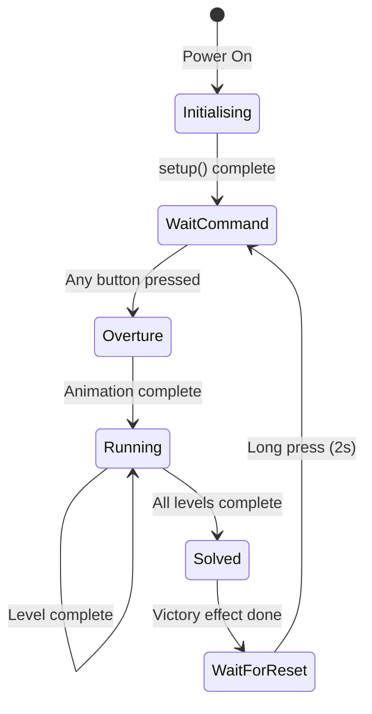

# SimonSays - Complete Algorithm and Structure (PropMaker EscapeRoom)

## Overview

SimonSays is an implementation of the classic "Genius" game for escape rooms, based on the **Adafruit PropMaker Feather RP2040** board and using the **PropMaker EscapeRoom** library.

The puzzle consists of 4 colored buttons (Red, Blue, Yellow, Green), each with a ring of 12 NeoPixel LEDs. The player must repeat a randomly generated sequence that grows progressively in length.

**Unique feature:** The system has NO penalty for mistakes. If the player makes a mistake, the same sequence is repeated until they get it right.

**Dual-Core Architecture (FreeRTOS):**
- Core 0: Game logic (sequence, inputs, states)
- Core 1: Audio system (MP3 decoder via I2S)

---

## Function Index

### 1. Structures and Constants
- [Configuration Constants](#configuration-constants)
- [GameStatus](#gamestatus)
- [Color Enum](#color-enum)

### 2. Setup and Initialization
- [setup()](#setup)
- [setupHardware()](#setuphardware)
- [generateGameSequence()](#generategamesequence)

### 3. Main Loop and States
- [update()](#update)
- [handleWaitCommand()](#handlewaitcommand)
- [handleOverture()](#handleoverture)
- [handleRunning()](#handlerunning)
- [handleSolved()](#handlesolved)
- [handleWaitForReset()](#handlewaitforreset)

### 4. Game Logic
- [playGame()](#playgame)
- [showSequence()](#showsequence)
- [checkPlayerInput()](#checkplayerinput)
- [calculateSpeed()](#calculatespeed)

### 5. Visual and Sound Effects
- [flashRing()](#flashring)
- [startRainbow()](#startrainbow)
- [updateRainbow()](#updaterainbow)
- [stopRainbow()](#stoprainbow)
- [resetAnimation()](#resetanimation)

### 6. Utilities
- [bubbleUnsort()](#bubbleunsort)
- [shuffleSwap()](#shuffleswap)

---

## Configuration Constants

```cpp
#define BUTTONS 4                    // Number of buttons/rings
#define NUM_LEDS_PER_RING 12         // LEDs per ring
#define TOTAL_LEDS (NUM_LEDS_PER_RING * BUTTONS)  // Total: 48 LEDs
#define MIN_LEVELS 2                 // Initial level
#define MAX_LEVELS 7                 // Maximum level
#define TIMEOUT 5000UL              // Input timeout (ms)
#define DEBOUNCE 100                // Button debounce (ms)
#define MAX_INTERVAL 800            // Maximum interval between flashes (ms)
#define MIN_INTERVAL 300            // Minimum interval between flashes (ms)
#define RESET_HOLD_TIME 2000UL      // Time to reset (ms)
#define RAINBOW_SPEED 15            // Rainbow animation speed
```

### Hardware Mapping

| Component | Pin | Description |
|------------|------|-----------|
| BUTTON_RED_PIN | PCF P0 | Red Button |
| BUTTON_BLUE_PIN | PCF P1 | Blue Button |
| BUTTON_YELLOW_PIN | PCF P2 | Yellow Button |
| BUTTON_GREEN_PIN | PCF P3 | Green Button |
| LOCK_PIN | PIN_EXTERNAL_POWER | Electric lock |
| LED_EXTERNAL | PIN_EXTERNAL_NEOPIXEL | External NeoPixel LEDs |

---

## GameStatus

Enumeration of the game states:

| State | Value | Description |
|--------|-------|-----------|
| Initialising | 0 | Boot state |
| WaitCommand | 1 | Waiting for a button to start |
| Overture | 2 | Opening animation |
| Running | 3 | Game running |
| Solved | 4 | Puzzle solved (box open) |
| WaitForReset | 5 | Waiting for manual reset |

### State Transition

```
Initialising → WaitCommand
                    ↓
              Overture (any button)
                    ↓
              Running (after the animation)
                    ↓
              Solved (MAX level reached)
                    ↓
         WaitForReset (after the victory effect)
                    ↓
              WaitCommand (manual reset)
```

---

## Color Enum

```cpp
enum Color {
    COLOR_RED = 0,      // Red
    COLOR_BLUE = 1,     // Blue
    COLOR_YELLOW = 2,   // Yellow
    COLOR_GREEN = 3     // Green
};
```

### Color → Index Mapping

| Color | Index | Sound | NeoPixel RGB |
|-----|--------|-----|--------------|
| Red | 0 | 1 | (255, 0, 0) |
| Blue | 1 | 2 | (0, 0, 255) |
| Yellow | 2 | 3 | (255, 215, 0) |
| Green | 3 | 4 | (0, 128, 0) |

---

## setup()

### Purpose
Initializes all the hardware and sets the game's initial state.

### Flow
1. Initializes Serial for debug
2. Calls `hw.begin()` to initialize the PropMaker
3. Adds the PCF8575 with `hw.addPcf8575(0x20)`
4. Configures the button pins as INPUT_PULLUP
5. Configures the lock as OUTPUT
6. Initializes the external NeoPixels
7. Generates the game sequence with `generateGameSequence()`
8. Plays the "ready" sound
9. Sets the initial state as `WaitCommand`

### Audio Files

| File | Description | Trigger |
|---------|-----------|---------|
| ready.mp3 | System ready | Boot |
| begin.mp3 | Game start | Overture |
| correct.mp3 | Correct sequence | After completing a level |
| error.mp3 | Sequence error | Wrong input |
| victory.mp3 | Victory | Puzzle solved |

---

## setupHardware()

### Purpose
Puzzle-specific configuration inherited from `PuzzleBase`.

### Actions
1. Configures the button pins via PCF8575
2. Initializes the lock (locked)
3. Configures the NeoPixel
4. Prepares the button listeners (SwitchInput)

---

## generateGameSequence()

### Purpose
Generates a random sequence of colors without consecutive repetitions.

### Algorithm
```
1. Creates the base sequence [RED, BLUE, YELLOW, GREEN, RED, BLUE, ...]
   repeating until reaching MAX_LEVELS elements

2. For each position i from 1 to MAX_LEVELS:
   If gameSequence[i] == gameSequence[i-1]:
     Find position j > i where:
       - gameSequence[j] != gameSequence[i-1]
       - gameSequence[j] != gameSequence[j+1] (if it exists)
     Swap gameSequence[i] with gameSequence[j]

3. Applies bubbleUnsort() to shuffle it further

4. Final verification:
   For each position i from 1 to MAX_LEVELS:
      If gameSequence[i] == gameSequence[i-1]:
         Find the first j > i where gameSequence[j] != gameSequence[i-1]
         Swap gameSequence[i] with gameSequence[j]
```

### Complexity
- **Time:** O(n²) in the worst case
- **Space:** O(n) to store the sequence

### Example Output
```
Generated sequence (MAX_LEVELS=7):
[RED, BLUE, RED, GREEN, YELLOW, BLUE, GREEN]
```

---

## update()

### Purpose
Main game state machine, called in the loop.

### Implementation
```cpp
void update() override {
    // Processes audio
    hw.sound().loop();
    
    // Runs the state machine
    switch (gameStatus) {
        case WaitCommand:    handleWaitCommand(); break;
        case Overture:       handleOverture(); break;
        case Running:        handleRunning(); break;
        case Solved:         handleSolved(); break;
        case WaitForReset:   handleWaitForReset(); break;
        default: break;
    }
    
    // Updates the rainbow animation if active
    if (rainbowActive) {
        updateRainbow();
    }
}
```

---

## handleWaitCommand()

### Purpose
Waits for any button press to start the game.

### Logic
```
1. Ensures the lock is locked
2. Updates the button state (switches.runLoop())
3. If ANY button is pressed:
   - delay(300) // debounce
   - gameStatus = Overture
```

---

## handleOverture()

### Purpose
Runs the introduction animation before starting the game.

### Sequence
```
1. Plays the "begin.mp3" sound
2. Lights all the rings with their colors
   (leds[0-11]=RED, leds[12-23]=BLUE, etc)
3. FastLED.show()
4. delay(1000)
5. Turns all the LEDs off
6. FastLED.show()
7. delay(1000)
8. gameStatus = Running
```

---

## handleRunning()

### Purpose
Manages the main game loop while it is running.

### Implementation
```cpp
void handleRunning() {
    digitalWrite(LOCK_PIN, LOW); // Locked
    playGame();
}
```

---

## playGame()

### Purpose
Main loop of the Simon Says game.

### Algorithm
```
WHILE gameStatus == Running:
    1. Shows the current sequence (showSequence)
    2. delay(500)
    
    3. result = checkPlayerInput()
    
    4. WHILE result == 0 (error):
         plays error.mp3
         delay(1000)
         shows the sequence again
         delay(500)
         result = checkPlayerInput() // tries again
    
    5. IF result == 1 (correct):
         plays correct.mp3
         
         IF currentLevel < MAX_LEVELS:
             currentLevel++
             gameSpeed = calculateSpeed(currentLevel)
         ELSE:
             gameStatus = Solved
```

---

## showSequence()

### Purpose
Displays the current color sequence for the player to memorize.

### Algorithm
```
FOR i = 0 TO currentLevel-1:
    1. Serial.print(colorName[gameSequence[i]])
    2. flashRing(gameSequence[i], gameSpeed)
    
delay(gameSpeed)
```

---

## flashRing()

### Purpose
Lights a complete ring of LEDs with a sound effect.

### Parameters
- `colorIdx`: Color index (0-3)
- `duration`: Flash duration in ms

### Implementation
```cpp
void flashRing(int colorIdx, int duration) {
    // Lights all the LEDs in the ring
    for (int i = colorIdx * NUM_LEDS_PER_RING; 
         i < (colorIdx + 1) * NUM_LEDS_PER_RING; 
         i++) {
        hw.setLight(i, COLORS[colorIdx]);
    }
    hw.pixelsExternal().show();
    
    // Plays the corresponding sound
    hw.sound().playOnce(COLOR_SOUNDS[colorIdx]);
    delay(duration);
    
    // Turns the LEDs off
    for (int i = colorIdx * NUM_LEDS_PER_RING; 
         i < (colorIdx + 1) * NUM_LEDS_PER_RING; 
         i++) {
        hw.setLight(i, 0);
    }
    hw.pixelsExternal().show();
    delay(duration);
}
```

---

## checkPlayerInput()

### Purpose
Captures and validates the player's input.

### Algorithm
```
FOR i = 0 TO currentLevel-1:
    button = -1
    startTime = millis()
    
    WHILE button == -1:
        updates the button state
        
        IF Red button pressed:   button = 0, break
        IF Blue button pressed:  button = 1, break
        IF Yellow button pressed: button = 2, break
        IF Green button pressed: button = 3, break
        
        IF millis() - startTime >= TIMEOUT:
            RETURN 0 // Timeout = error
    
    flashRing(button, 500) // Visual feedback
    
    IF button != gameSequence[i]:
        RETURN 0 // Wrong button
    
    correctMove++

plays correct.mp3
correctMove = 0
delay(500)
RETURN 1 // Success
```

### Return Values
- `1`: Complete correct sequence
- `0`: Error (wrong button or timeout)

---

## calculateSpeed()

### Purpose
Calculates the game speed based on the current level.

### Algorithm
```
INPUT: level (MIN_LEVELS to MAX_LEVELS)

levelProgress = MAX_LEVELS - MIN_LEVELS
totalReduction = MAX_INTERVAL - MIN_INTERVAL
reductionPerLevel = totalReduction / levelProgress

speed = MAX_INTERVAL - ((level - MIN_LEVELS) * reductionPerLevel)
speed = constrain(speed, MIN_INTERVAL, MAX_INTERVAL)

RETURN speed
```

### Example
```
MIN_LEVELS=2, MAX_LEVELS=7
MAX_INTERVAL=800, MIN_INTERVAL=300

Level 2: 800ms
Level 3: 700ms
Level 4: 600ms
Level 5: 500ms
Level 6: 400ms
Level 7: 300ms
```

---

## handleSolved()

### Purpose
Performs actions when the puzzle is solved.

### Sequence
```
1. Serial.println("Box Open")
2. Plays victory.mp3
3. Starts the rainbow animation (startRainbow)
4. Opens the lock (digitalWrite HIGH)
5. delay(5000) // Waits for stabilization
6. gameStatus = WaitForReset
```

---

## handleWaitForReset()

### Purpose
Waits for a manual reset by pressing any button for 2 seconds.

### Algorithm
```
Serial.println("Waiting for Reset")

pressStart = 0
pressed = false

WHILE NOT pressed:
    updateRainbow() // Keeps the animation
    hw.sound().loop()
    updates the button state
    
    IF any button pressed:
        IF pressStart == 0:
            pressStart = millis()
        IF millis() - pressStart >= RESET_HOLD_TIME:
            stopRainbow()
            resetAnimation()
            resetGame()
            pressed = true
    ELSE:
        pressStart = 0 // Resets the timer if released
    
    delay(50)
```

---

## startRainbow()

### Purpose
Starts the rainbow animation on the LED rings.

### Configuration
```cpp
rainbowActive = true
gHue = 0
lastRainbowUpdate = millis()
```

---

## updateRainbow()

### Purpose
Updates a frame of the rainbow animation.

### Algorithm
```
IF !rainbowActive: RETURN

IF millis() - lastRainbowUpdate < RAINBOW_SPEED: RETURN

lastRainbowUpdate = millis()

// Turns all the LEDs off
FOR i = 0 TO TOTAL_LEDS-1:
    leds[i] = BLACK

// For each ring, lights 1 LED with a rainbow color
FOR ring = 0 TO BUTTONS-1:
    ledPos = (ring * NUM_LEDS_PER_RING) + (gHue % NUM_LEDS_PER_RING)
    leds[ledPos] = CHSV(gHue + (ring * 64), 255, 255)

FastLED.show()
gHue++
```

---

## stopRainbow()

### Purpose
Stops the animation and turns all the LEDs off.

### Implementation
```cpp
rainbowActive = false

FOR i = 0 TO TOTAL_LEDS-1:
    hw.setLight(i, 0)

hw.pixelsExternal().show()
```

---

## resetAnimation()

### Purpose
Runs the reset visual animation before restarting.

### Sequence
```
1. Individual cycle (4 cycles):
   FOR each ring (0 to 3):
       FOR each LED in the ring (0 to 11):
           Lights the LED with the ring's color
           delay(50)
           Turns the LED off
           delay(50)

2. Two general blinks:
   REPEAT 2 times:
       Lights all the LEDs with their respective colors
       delay(150)
       Turns them all off
       delay(150)

3. Ensures the lock is locked
```

---

## resetGame()

### Purpose
Restarts the game to its initial conditions.

### Actions
```
1. currentLevel = MIN_LEVELS
2. gameSpeed = MAX_INTERVAL
3. Generates a new sequence (generateGameSequence)
4. delay(1000)
5. Plays ready.mp3
6. delay(500)
7. gameStatus = WaitCommand
```

---

## bubbleUnsort()

### Purpose
Shuffles an array using an inverted bubble sort algorithm.

### Implementation
```cpp
void bubbleUnsort(int* list, int elem) {
    for (int a = elem - 1; a > 0; a--) {
        int r = random(a + 1);
        if (r != a) {
            int temp = list[a];
            list[a] = list[r];
            list[r] = temp;
        }
    }
}
```

### Complexity
- **Time:** O(n²)
- **Space:** O(1)

---

## shuffleSwap()

### Purpose
Swaps the position of two elements in an array.

### Parameters
- `index_a`: First position
- `index_b`: Second position
- `array`: Pointer to the array
- `size`: Size of each element (sizeof(int))

---

## Complete State Diagram



---

## Audio Configuration

### Required MP3 Files

| File | Folder | Description |
|---------|-------|-----------|
| ready.mp3 | / | System initialized |
| begin.mp3 | / | Game start |
| correct.mp3 | / | Correct sequence |
| error.mp3 | / | Sequence error |
| victory.mp3 | / | Puzzle solved |
| red.mp3 | / | Red button sound |
| blue.mp3 | / | Blue button sound |
| yellow.mp3 | / | Yellow button sound |
| green.mp3 | / | Green button sound |

### Format
- Rate: 128Kbps
- Sample rate: 44.1kHz
- Channels: Stereo
- No ID3 tags (use ffmpeg with `-map_metadata -1`)

---

## State Variables

| Variable | Type | Description |
|----------|------|-----------|
| gameStatus | GameStatus | Current game state |
| currentLevel | int | Current level (2-7) |
| gameSpeed | int | Flash speed (ms) |
| gameSequence[] | int[7] | Generated sequence |
| rainbowActive | bool | Rainbow animation active |
| gHue | uint8_t | Current hue for the rainbow |

---

## Code Conventions

1. **States:** Always use the `GameStatus` enum, never magic values
2. **Colors:** Use the `Color` enum or `COLOR_*` constants
3. **Timeouts:** Use `millis()` to be non-blocking
4. **Audio:** Always call `hw.sound().loop()` in update
5. **NeoPixel:** Use `hw.setLight()` for consistency
6. **Inputs:** Use SwitchInput/IoAbstraction for debouncing